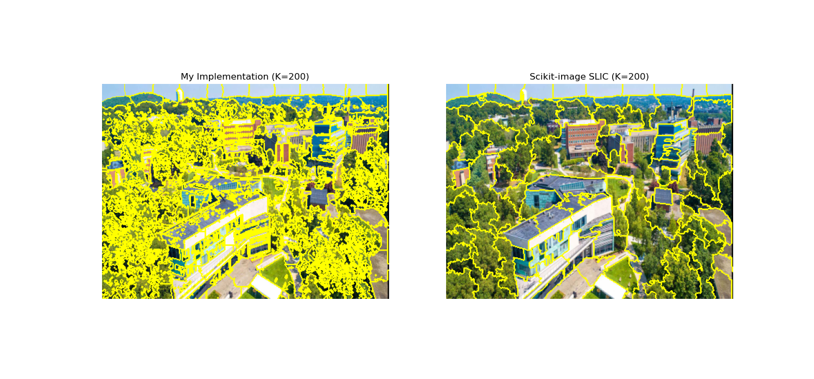

# SLIC Superpixels from Scratch & Grad-CAM

Individual computer vision project with two parts:

1. **SLIC superpixels, implemented from scratch** in NumPy and compared with scikit-image.
2. **Visual explanations for a CNN** with Grad-CAM, vanilla backpropagation and Guided Grad-CAM on a
   pretrained ResNet-50.

## Part 1: SLIC Superpixel Segmentation

SLIC (Simple Linear Iterative Clustering) is k-means clustering on pixels described by CIELAB color
and position. Each center only competes for pixels in a 2S × 2S window around it, where
S = √(N/K) is the grid spacing for N pixels and K target superpixels. The distance combines color
distance d_c and spatial distance d_s, balanced by the compactness m:

<p align="center"><b>D = √( d<sub>c</sub><sup>2</sup> + (m / S)<sup>2</sup> d<sub>s</sub><sup>2</sup> )</b></p>

My implementation (`slic.py`) includes grid initialization, windowed assignment with vectorized
distance computation, and center updates, run for 10 iterations. It does not include
gradient-based center initialization or connectivity enforcement.

### Results

Test image: 300 × 400 photo of the Brandeis campus, compactness m = 10 in both implementations.



*My implementation (left) vs. scikit-image with default settings (right), K = 200.*

| K | Version | Superpixels | Pixels in disconnected fragments | Color std inside a superpixel (LAB) | Runtime |
| --- | --- | ---: | ---: | ---: | ---: |
| 50 | Mine | 48 | 32.7% | 9.1 | 0.53 s |
| 50 | scikit-image, connectivity off | 48 | 57.1% | – | – |
| 50 | scikit-image, default | 14 | 0% | 12.9 | 0.11 s |
| 200 | Mine | 204 | 28.2% | 6.8 | 1.48 s |
| 200 | scikit-image, connectivity off | 204 | 44.0% | – | – |
| 200 | scikit-image, default | 91 | 0% | 9.9 | 0.12 s |
| 500 | Mine | 540 | 26.6% | 5.7 | 3.44 s |
| 500 | scikit-image, connectivity off | 540 | 35.8% | – | – |
| 500 | scikit-image, default | 291 | 0% | 8.5 | 0.10 s |

**Key findings**

- **The visible difference comes from connectivity enforcement.** With it switched off,
  scikit-image produced the same number of superpixels as my code and an equal or larger share of
  fragmented pixels, so the fragmentation is a property of color-driven clustering on this textured
  image, not a bug in my implementation.
- **Connectivity enforcement is a trade-off.** It merges fragments into compact, connected regions
  (14, 91 and 291 instead of the requested 50, 200 and 500), but each region becomes 40–50% less
  uniform in color.
- **Larger K follows finer structure.** Average superpixel size fell from 2,500 to 588 to 222
  pixels, and color variation within superpixels fell with it.
- **Speed.** My Python loop over centers was 5–34× slower than scikit-image's compiled Cython.

More results: `comparison_K_50.png`, `comparison_K_500.png`, and `slic_result_K_*.png`.

## Part 2: Grad-CAM and Gradient-Based Visualization

`gradcam.py` applies three visualization methods to a pretrained ResNet-50 (torchvision), using the
[`pytorch-grad-cam`](https://github.com/jacobgil/pytorch-grad-cam) library:

- **Grad-CAM:** a coarse heatmap of the regions that most influence the predicted class.
- **Vanilla backpropagation:** pixel-level gradients of the prediction with respect to the input.
- **Guided Grad-CAM:** guided backpropagation weighted by the Grad-CAM map, combining localization with
  fine detail.

The script also generates Grad-CAM maps at five depths of the network (`relu`, `layer1` to `layer4`)
to compare how attention changes with depth, and tests robustness to a 90° rotation and to Gaussian
input noise (σ = 0.05).

## Repository Structure

```text
SLIC-Superpixels-GradCAM/
├── README.md
├── requirements.txt
├── slic.py                 # SLIC implementation and scikit-image comparison
├── gradcam.py              # Grad-CAM, vanilla backprop, Guided Grad-CAM, layer and robustness experiments
├── brandeis_campus.jpg     # test image
├── comparison_K_50.png     # my SLIC vs. scikit-image, K = 50
├── comparison_K_200.png    # K = 200
├── comparison_K_500.png    # K = 500
├── slic_result_K_50.png
├── slic_result_K_200.png
├── slic_result_K_500.png
└── my_slic_k50.png
```

## Running

```bash
pip install -r requirements.txt
python slic.py      # SLIC experiments and comparison figures
python gradcam.py   # Grad-CAM visualizations
```

## Next Steps

- Add connectivity enforcement and gradient-based initialization, then compare with scikit-image again.
- Evaluate on BSDS500 with boundary recall and undersegmentation error.
- Sweep the compactness m to map the trade-off between boundary adherence and regularity.

## References

- Achanta, R., et al. (2012). [SLIC Superpixels Compared to State-of-the-Art Superpixel Methods](https://doi.org/10.1109/TPAMI.2012.120). IEEE TPAMI 34(11).
- Selvaraju, R. R., et al. (2017). [Grad-CAM: Visual Explanations from Deep Networks via Gradient-based Localization](https://arxiv.org/abs/1610.02391). ICCV 2017.
